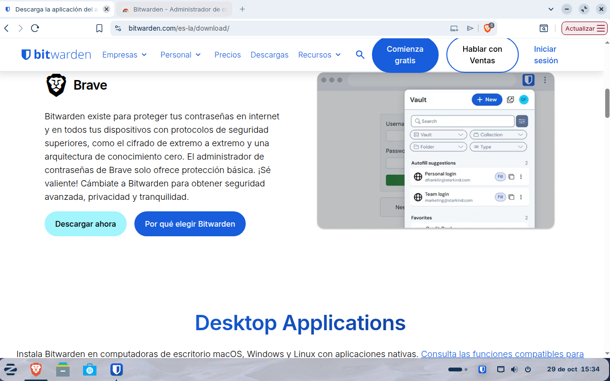
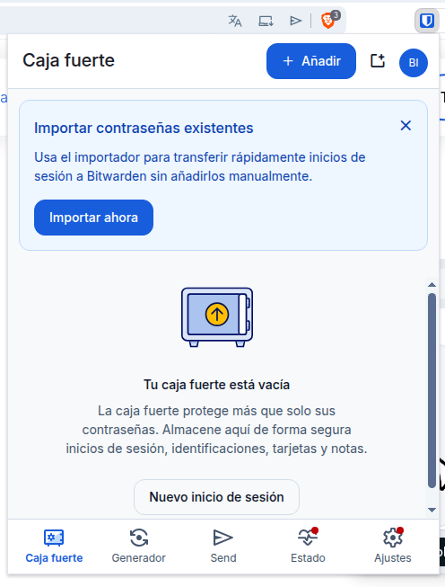
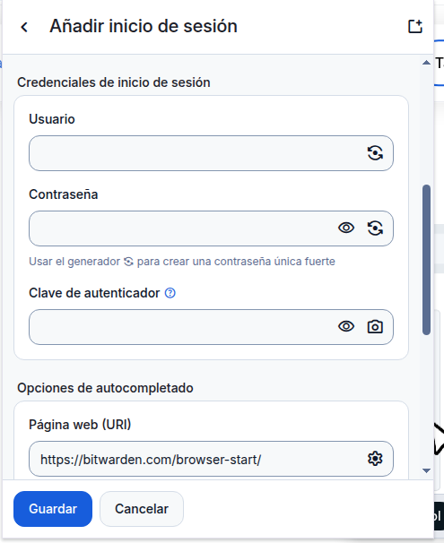
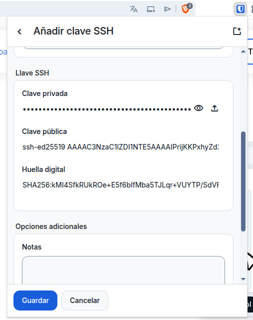
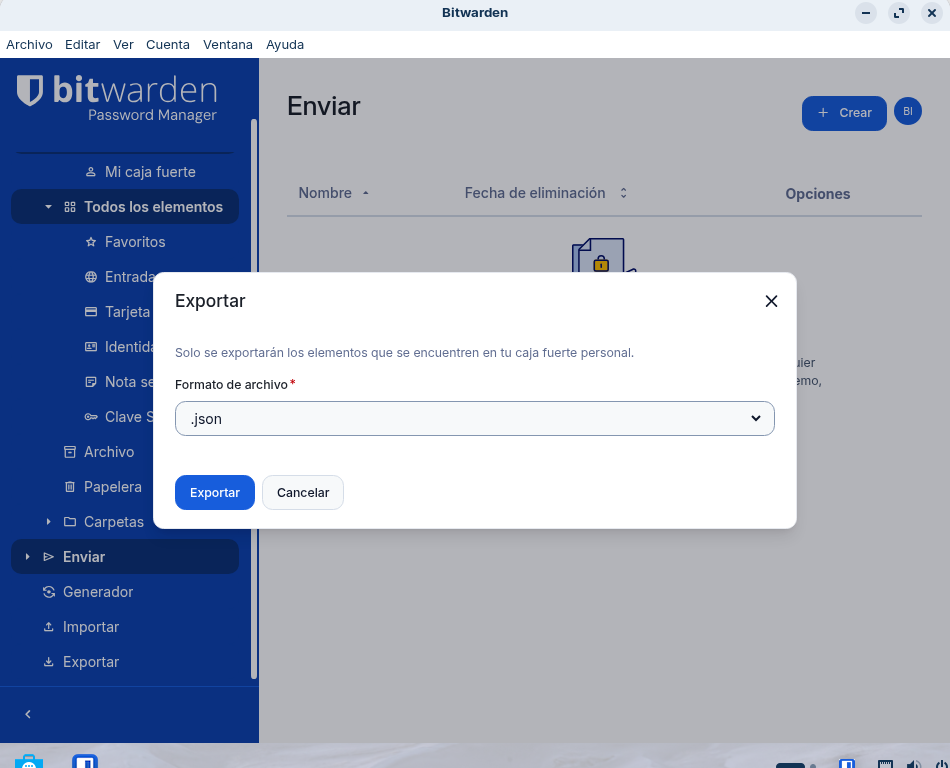

## FASE 2

Instal·lació i Configuració Inicial: Descàrrega, instal·lació i creació de la BBDD principal o compte mestre.

Generació de Contrasenyes Segures: Explicació de com utilitzar el generador de contrasenyes de l'eina (paràmetres, longitud, caràcters especials).

Instalo la extensio de Bitwarden s'utilitza de la mateixa forma que en la aplicacio

Aixi es fa una exportacio a l'esquerra de la aplicacio et surten opcion y si baixas et surt la opcio de exportar

La guardaria en una clau USB xifrada i en un lloc segur. Així, si perdo la clau USB, ningú podrà veure les contrasenyes fàcilment.

